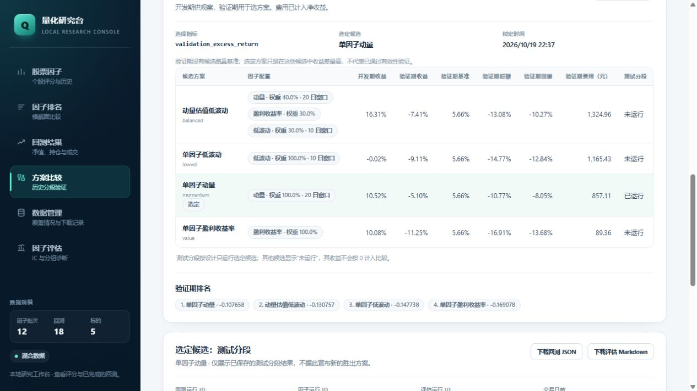

# 历史分段验证与方案比较

本阶段复用 Qlib 原生回测和既有因子诊断，新增实验编排、选择记录、报告和网页“方案比较”。使用现有联合快照离线计算，不再请求供应商。**这批历史数据此前已经用于研究，本次属于回溯分段检验，不能声称是真正首次接触的样本外测试。**

## 使用

在项目根目录执行：

```powershell
.\.venv\Scripts\python.exe -m finance_quant.cli experiment --config configs\research.joint.json --plan configs\experiment.historical.json
.\start.ps1
```

启动网页后选择左侧“方案比较”。实验命令不会修改当前激活的研究配置；启动脚本也不会自动重跑实验。修改代码、数据、候选因子、切分或共用参数会生成新的实验 ID；同版本重跑核验引用产物校验和并复用结果。

## 默认计划

| 区间 | 日期 | 交易日 | 用途 |
| --- | --- | ---: | --- |
| 开发 | 2025-03-03 至 2025-12-31 | 207 | 观察各方案的历史行为 |
| 验证 | 2026-01-05 至 2026-05-29 | 95 | 按事先声明的规则选择方案 |
| 测试 | 2026-06-01 至 2026-09-30 | 86 | 只运行锁定方案 |

四个候选为原有动量/估值/低波动加权方案，以及单因子动量、盈利收益率、低波动。当前是手工因子评分，没有机器学习训练；“开发区间”也不应称为模型训练集。

选择规则固定为**验证区间累计净收益减去基准累计收益**，取最大值；完全同分时按候选 ID 升序。该值是收益的算术差，未做风险调整，不是 alpha。开发与测试收益不参与程序选择。测试区间仅运行选中的一个方案，其他候选显示“未运行”，不能补零。

每个方案和每个区间均从相同初始资金、空仓开始，使用相同股票池、基准、持仓参数和费用。期末收盘估值，未强制清仓，区间之间不承接持仓、不能拼接成一条连续净值。策略复权收益和价格指数的分红口径不同，收益差仍含有这一口径影响。

## 时间与数据边界

- 计划严格校验字段、候选 ID、权重和窗口；不能配置重叠、逆序或遗漏实际交易日的区间。
- 区间必须在研究配置的回测范围内，边界必须是实际交易日，每段长度超过最长诊断持有期。
- 计算开始时锁定具体物理快照目录，避免默认指针在多个子任务之间改变。
- 所有候选在每个决策日必须能对整个声明股票池打分；预热不足或缺值直接拒绝，避免比较期间偷偷换股票池。
- 因子滚动计算只使用当前及以前的行情，允许使用上一区间的历史预热。信号日评分用于下一交易日开盘。
- IC/分组标签采用下一交易日开盘入场，持有指定交易日后开盘离场。入场和离场均限制在当前区间，尾部不足持有期的标签剔除；不从下一段借用收益。
- 候选及区间先写入不可变计划；全部验证结果生成后写入不可变选择记录；文件发布成功后才调用测试回测。中断重跑必须使用完全一致的选择证据。

## 产物与接口

`runs/experiments/{id}/` 包含 `plan.json`、`selection.json`、完成后才发布的 `result.json` 和 `report.md`。未完成实验不会出现在网页列表中。回测和诊断仍由原工作流发布在各自目录；实验记录引用 ID、因子 ID、校验和、数据版本和代码/依赖/Python 指纹，保留过去结果。

只读接口：

- `GET /api/v1/experiments`
- `GET /api/v1/experiments/{id}`
- `GET /api/v1/experiments/{id}/download`
- `GET /api/v1/experiments/{id}/report`

网页提供切分区间、共用参数、验证结果比较、选中方案测试指标，以及 JSON/Markdown 下载。已有回测页面仍可查看子回测的净值、持仓与成交。

## 本次验收结果

- 数据版本：`joint-157dbae708578dd6`；实验：`split-911d06185b9f`。
- 4 个候选各运行开发和验证区间，选中动量方案后只运行它的测试区间，共 9 组原生 Qlib 回测和配套诊断。
- 四候选在验证区间均跑输基准；动量只是验证期收益差最高的候选，验证期净收益 -5.10%、基准 +5.66%、收益差 -10.77 个百分点。
- 动量测试期净收益 +2.96%、基准 -10.93%、收益差 +13.89 个百分点，最大回撤 -9.05%；不能据此证明策略有效，也不能消除先前看过数据所带来的偏差。
- 全量 302 项 Python 测试通过；TypeScript 与生产构建通过；本地 HTTP 结果/下载接口和浏览器页面验收通过，浏览器无控制台错误。
- 额外独立核对 1,294 个账户日的现金、持股市值、净值和累计费用，以及 18,690 条远期收益标签的实际开盘价、复权比例、交易日偏移和区间边界。
- 同指纹第二次运行复用已有实验，引用产物校验和一致；原激活配置、原联合数据快照及历史结果保留。

构建仍有既有前端包体积提示，Qlib/数值依赖仍会产生弃用和小样本空值提示；验收通过不表示生产市场规则已经完整覆盖。



## 尚未完成

- 真正未见数据上的前瞻验证、滚动训练与滚动选参、嵌套交叉验证。
- 多重试验校正、置信区间和显著性检验。
- 历史指数成分/退市股票、全市场与长时间覆盖。
- 财报公告/修订版本的真实接入，历史估值时点的独立审计。
- 停复牌缺口、交易容量、滑点、历史税费拆分与现金分红账本。
- 网页参数编辑、任务提交/取消、后台队列和自动更新。

不要反复观察测试结果后改参数，再把同一段称作新的未见测试。下一次严肃策略评估应预先冻结规则，并记录每次尝试。
