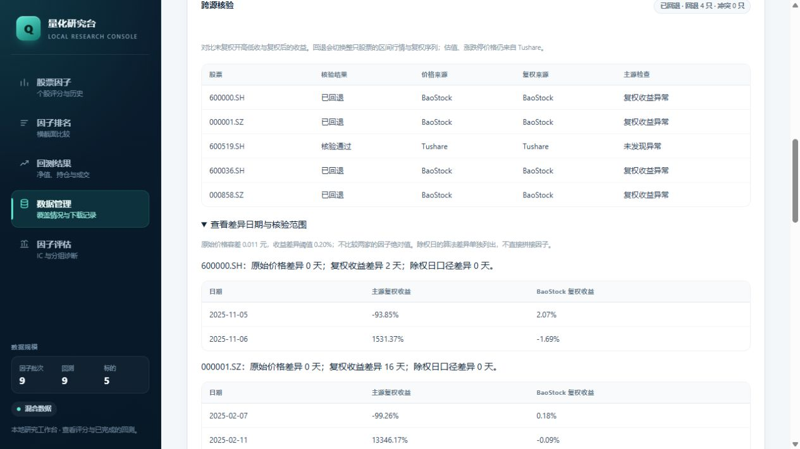

# Tushare 与 BaoStock 联合核验

验收日期：2026-10-19。主源是用户提供的第三方 Tushare 兼容服务，第二来源为 BaoStock SDK 0.9.4。

## 实际结果

五股2025-01-01至2026-09-30，共424个交易日、2120条日线，逐日对照未复权开高低收；两源均在0.011元容差内一致。原候选的30处复权收益异常未出现在BaoStock后复权序列中。

| 股票 | 主源复权收益异常数 | 最终价格与复权来源 |
| --- | ---: | --- |
| 600000.SH 浦发银行 | 2 | BaoStock，整段回退 |
| 000001.SZ 平安银行 | 16 | BaoStock，整段回退 |
| 600519.SH 贵州茅台 | 0 | 保留 Tushare |
| 600036.SH 招商银行 | 6 | BaoStock，整段回退 |
| 000858.SZ 五粮液 | 6 | BaoStock，整段回退 |

浦发2025-11-05：原因子算出约-93.85%，BaoStock约+2.07%；次日原因子约+1531.37%，BaoStock约-1.69%。未复权价格相符，问题集中于主源复权序列。详见[原始证据](provider-data-issues.md)。

新快照`joint-157dbae708578dd6`，回测`real-qlib-4a50e7cc249a`，评分`real-factors-c29f6e97438d`，评估`factor-eval-7717d014d519`。原候选继续隔离，没有修改或宣称供应商已修复；原短区间数据也保留。

## 使用

当前已激活`configs/research.joint.json`的联合配置，直接运行：

```powershell
.\start.ps1
```

网页“数据管理 → 跨源核验”显示逐股来源、回退原因与差异日期。启动只计算或复用冻结结果，不联网下载。显式指定配置也可使用：

```powershell
.\start.ps1 -Config configs\research.joint.json
```

需要下载或更新时：

```powershell
.\.venv\Scripts\python.exe -m finance_quant.cli plan --config configs\research.joint.json
.\.venv\Scripts\python.exe -m finance_quant.cli download --config configs\research.joint.json
```

首次建立其他目录时，可只读复用已有同源原始响应：

```powershell
.\.venv\Scripts\python.exe -m finance_quant.cli download --config configs\research.joint.json --primary-cache-from data\managed
```

缓存须同源、同参数且校验和正确；已有按日补抓记录也先复用。`--refresh`使用新下载代次和BaoStock缓存空间，不能同时指定旧主源缓存。原短区间`research.verified.json`仍可运行。

## 配置与边界

在`data`内增加可选的`"validation": {"mode": "fallback"}`：

| 模式 | 行为 |
| --- | --- |
| off | 原有Tushare流程，不调用BaoStock；旧配置默认值 |
| verify | 双源核验，不替换；异常或冲突时拒绝发布 |
| fallback | 主源明确缺失/异常、第二源合格时允许整段回退 |

两源都看似合理却冲突，或BaoStock不可用、缺行、自身异常时，停止发布并保留上一有效快照。损坏缓存等完整性错误不会被回退掩盖。

目前回退范围是**股票日线与复权**。估值、涨跌停、指数、日历和当前股票资料仍来自主源；必需接口失败时不以不同字段静默替换。仅支持沪深股票；停牌缺口、退市及北交所不在本次支持范围。

## 计算原则

不比较两家因子的绝对值，不逐行拼接因子。第二来源同时取得不复权日线（`adjustflag=3`）及后复权日线（`adjustflag=1`），检查代码、日期、交易状态、价格、OHLC一致性及其自身复权收益与涨跌幅。

回退使用整只股票、完整区间的BaoStock行情，以“后复权收盘价 / 原始收盘价”得到因子，再按区间首日归一化；不使用未来终点作锚，不填邻日值掩饰异常。行级字段记录价格、复权、估值和限制价各自的来源。

非除权日收益差异阈值0.002；两边因子均变化的除权日口径差异单独列出。政策参数、核验记录、原始响应校验和和校验代码指纹一起进入快照。

BaoStock使用涨跌幅复权法，不能作为实际参加分红配股的现金账本。见官方[BaoStock复权因子简介](https://www.baostock.com/helpdocs/pdf/BaoStock%E5%A4%8D%E6%9D%83%E5%9B%A0%E5%AD%90%E7%AE%80%E4%BB%8B.pdf)。

## 工程验收

- SDK在独立子进程登录与查询，有硬超时；原始响应Parquet按请求、SDK版本缓存，校验和错误拒绝。
- market-v3加载时再次检查质量、核验状态和逐行来源。评分、回测JSON及Markdown报告保留来源；HTTP查询不执行下载。
- 全量279项测试、前端构建、Windows PowerShell 5.1启动及HTTP接口通过；浏览器已实测来源表、差异展开与评估持有期切换。
- 回测2025-03-03至2026-09-30，共388天、389个净值点、1012条持仓、165笔成交；每日现金加股票市值与账户资产已对账。
- 1/5/10日收益标签1935/1915/1890条，合计5740条，逐条核对交易日及复权开盘收益。

通过的是当前五股区间的工程核验，仍有固定池偏差、估值发布时间未审计等限制，不代表全市场、财报或完整交易制度已验收。


